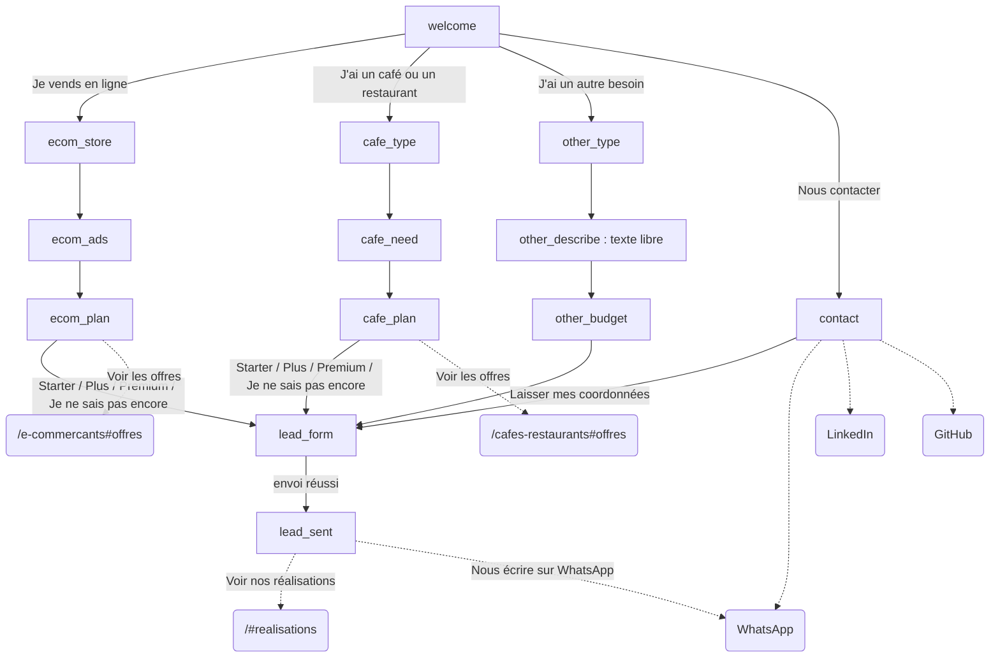

# Assistant Info Expertise (chatbot)

Assistant **à règles**, en français uniquement, qui oriente les visiteurs vers l'une des deux niches
du site (e-commerçants, cafés & restaurants) ou vers un autre besoin, puis recueille leurs coordonnées.

- **Aucune IA, aucune API externe, aucun texte généré** : chaque message est écrit à la main dans
  `app/data/chatbot/conversation.ts`.
- Rien ne quitte le navigateur tant que le visiteur n'a pas envoyé le formulaire.
- Monté **une seule fois** dans `app/layout.tsx` : la conversation suit la navigation entre les pages.
- **Chargé à la demande** : au départ, seuls le bouton et l'invitation sont dans le JS de la page.
  Le moteur, l'arbre et le panneau (`ChatPanel`, via `next/dynamic`) sont téléchargés au survol
  ou au focus du bouton, et affichés au clic. Une fois chargé, `ChatPanel` reste monté
  (même panneau fermé) pour garder la conversation.

---

## Fichiers

| Fichier | Rôle |
|---|---|
| `app/types/chatbot.ts` | Types : `ChatNode`, `ChatOption`, `ChatWidget`, `ChatEntry`, `LeadDraft` |
| `app/data/chatbot/conversation.ts` | **L'arbre complet** + `collectingNodes` + `brokenLinks()` |
| `app/data/chatbot/contact.ts` | Liens WhatsApp, LinkedIn, GitHub (identiques au footer, `content/site.ts`) |
| `useChatbot.ts` | Moteur : historique, nœud courant, pile « Retour », réponses recueillies |
| `Chatbot.tsx` | Bouton flottant, bulle d'invitation, ouverture / fermeture, chargement à la demande |
| `ChatPanel.tsx` | Partie chargée à la demande : `useChatbot` + `ChatWindow` |
| `ChatWindow.tsx` | Panneau : en-tête, fil, formulaire, options, champ texte |
| `ChatMessage.tsx` | Une bulle (bot ou visiteur) |
| `ChatOptions.tsx` / `ChatOption.tsx` | Boutons de choix + rangée « Retour / Accueil » |
| `ChatInput.tsx` | Champ texte libre (seulement si le nœud le demande) |
| `ChatLeadForm.tsx` | Formulaire de coordonnées → `POST /api/contact` |
| `ChatTeaser.tsx` | Bulle d'invitation (écrans ≥ 768 px) |
| `components/ui/Turnstile.tsx` | Widget Cloudflare Turnstile (partagé avec le formulaire du footer) |
| `worker/index.ts` | Route `/api/contact` : variante `source: "chatbot"`, vérification Turnstile |
| `app/globals.css` | Animations `chat-*` (coupées sous `prefers-reduced-motion`) |

---

## Modèle de données

```ts
interface ChatNode {
  id: string;
  message: string;          // "\n" conservé à l'affichage
  options?: ChatOption[];
  widget?: ChatWidget;      // { kind: "text", placeholder, next } | { kind: "leadForm", next }
  collect?: LeadField;      // enregistre le libellé choisi
  hideNav?: boolean;        // accueil uniquement
}

interface ChatOption {
  label: string;
  next?: string;            // nœud suivant
  href?: string;            // ou lien : "/page#ancre", "#ancre", URL externe
}

type LeadField = "store" | "ads" | "business" | "need" | "plan" | "projectType" | "budget";
type LeadDraft = Partial<Record<LeadField, string>> & { description?: string };
```

---

## Arbre de conversation



| Nœud | `collect` | Message | Choix |
|---|---|---|---|
| `welcome` | — | Bonjour, nous sommes Info Expertise. … | 4 entrées (ci-dessus) |
| `ecom_store` | `store` | Avez-vous déjà une boutique en ligne ? | 3 réponses → `ecom_ads` |
| `ecom_ads` | `ads` | Faites-vous de la publicité sur Facebook ou TikTok ? | Oui / Pas encore → `ecom_plan` |
| `ecom_plan` | `plan` | Quelle offre vous intéresse ? | 4 offres → `lead_form`, « Voir les offres » |
| `cafe_type` | `business` | Quel type d'établissement avez-vous ? | 5 types → `cafe_need` |
| `cafe_need` | `need` | Qu'est-ce qui vous intéresse le plus ? | 4 besoins → `cafe_plan` |
| `cafe_plan` | `plan` | Quelle offre vous intéresse ? | 4 offres → `lead_form`, « Voir les offres » |
| `other_type` | `projectType` | De quoi avez-vous besoin ? | 3 réponses → `other_describe` |
| `other_describe` | (description) | Décrivez votre besoin en quelques mots. | texte libre → `other_budget` |
| `other_budget` | `budget` | Quel est votre budget approximatif ? … | 6 tranches → `lead_form` |
| `lead_form` | — | Merci. Laissez-nous vos coordonnées, … | formulaire → `lead_sent` |
| `lead_sent` | — | Merci, votre demande est bien envoyée. … | réalisations, WhatsApp |
| `contact` | — | Comment souhaitez-vous nous contacter ? | WhatsApp, formulaire, LinkedIn, GitHub |

« Retour » et « Accueil » sont ajoutés automatiquement sous chaque nœud sauf `welcome`.
« Accueil » remet aussi les réponses recueillies à zéro, pour qu'une branche abandonnée
ne parte pas dans l'e-mail.

---

## Moteur (`useChatbot`)

- `select(option)` : affiche le choix, l'enregistre si le nœud a `collect`, avance.
- `submitText(text)` : enregistre le texte libre dans `description`, avance.
- `goBack()` / `goHome()` : pile des nœuds visités / retour à l'accueil.
- `advance(id)` : avance sans message du visiteur (après l'envoi du formulaire).
- Chaque réponse arrive après **420 ms** avec trois points animés (délai à ne pas allonger).
- En développement, `brokenLinks()` signale dans la console toute option pointant vers un nœud inexistant.

---

## Formulaire et envoi

| Champ | Obligatoire | Validation |
|---|---|---|
| Nom | Oui | 2 à 100 caractères |
| Téléphone / WhatsApp | Oui | Algérie (05/06/07 + 8 chiffres, fixe 0 + 8 chiffres) ou international (+XX / 00XX) |
| E-mail | Non | format e-mail si rempli |
| Description | Non | 2000 caractères max, pré-remplie avec le texte libre |

Anti-spam, comme le formulaire du footer :
- champ piège caché `website` : s'il est rempli, le Worker répond OK sans rien envoyer ;
- **Cloudflare Turnstile** (mode « interaction-only », invisible sauf doute). Actif seulement si
  les deux clés sont définies : `NEXT_PUBLIC_TURNSTILE_SITE_KEY` au build (client) et
  `TURNSTILE_SECRET_KEY` côté Worker (`npx wrangler secret put TURNSTILE_SECRET_KEY`,
  `.dev.vars` en local). Le jeton est à usage unique : le widget est réinitialisé après chaque envoi.

Requête envoyée :

```json
{
  "name": "…", "phone": "…", "email": "…", "message": "…", "website": "",
  "page": "E-commerçants",
  "source": "chatbot",
  "answers": { "Avez-vous déjà une boutique en ligne ?": "Oui, mais je veux la refaire" },
  "turnstileToken": "…"
}
```

`answers` associe la première ligne du message de chaque nœud `collect` (et du nœud texte libre)
à la réponse donnée, dans l'ordre de l'arbre.

Côté Worker (`worker/index.ts`), quand `source === "chatbot"` :
- sujet : `[Chatbot] Nouvelle demande — {page} — {nom}` ;
- corps : ligne `Source : chatbot` (le footer envoie `Source : formulaire du site`), nom, téléphone,
  e-mail, description, puis toutes les réponses de l'assistant ;
- e-mail en **texte brut** (pas de HTML, donc rien à échapper) ; les champs d'une ligne (nom,
  téléphone, e-mail, page, questions) sont ramenés sur une seule ligne pour qu'un retour à la
  ligne n'altère ni le sujet ni le corps ;
- même validation et même anti-spam que le footer, plus : e-mail valide si fourni,
  `answers` = objet de 12 entrées max (question ≤ 120, réponse ≤ 2000 caractères).

En cas d'échec, le formulaire affiche l'erreur et un bouton WhatsApp. En cas de succès → `lead_sent`.

---

## Interface

- **Bouton** : rond 56 px, fond `#0A0A0A`, icône bulle blanche, `aria-label="Ouvrir l'assistant"`.
- **Invitation** : « Une question sur votre projet ? Nous vous orientons en 30 secondes. »,
  après 4 s, écrans ≥ 768 px uniquement ; une fois fermée (ou le chat ouvert), elle ne revient plus
  pendant la session (`sessionStorage`), mais réapparaît à la visite suivante.
- **Panneau** : fond blanc, bordure 1 px `#0A0A0A`, rayon 4 px, Inter Tight. En-tête « Info Expertise »
  + « ASSISTANT » (12 px, `#6F6E6A`).
- **Bulles** : bot `#F4F3EE` / `#0A0A0A` ; visiteur `#0A0A0A` / `#F4F3EE`.
- **Choix** : contour 1 px `#0A0A0A`, 14 px, survol noir texte blanc, 44 px min.
- **Accent** `#C92A14` : point de l'invitation, indicateur du bouton, messages d'erreur.
- **Mobile** : panneau presque plein écran, réduit au-dessus du clavier via `visualViewport`.

## Accessibilité

`role="dialog"` + `aria-modal="true"` avec focus à l'ouverture, **piège à focus** (Tab et Maj+Tab
bouclent dans le panneau), Échap pour fermer, focus rendu au bouton ;
fil en `role="log"` + `aria-live="polite"` ; champs avec `label`, `aria-invalid`, `aria-describedby` ;
cibles ≥ 44 px ; animations coupées sous `prefers-reduced-motion`.

---

## Ajouter une branche

1. Ajouter un nœud dans `conversation.ts` (id unique, `message`, `options`).
2. Faire pointer une option existante vers lui avec `next: "<id>"`.
3. Optionnel : `collect` pour envoyer la réponse dans l'e-mail (ajouter le champ à `LeadField`).

N'utiliser que des liens réels ; garder `contact.ts` synchronisé avec `content/site.ts`.
